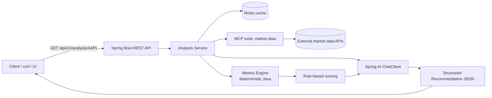

# MarketLens

AI-assisted stock analysis backend. Give it a ticker; it pulls fundamentals, the two most recent earnings reports and the broader market context, then returns a structured **BUY / HOLD / SELL** view with the reasoning behind it.

> ⚠️ **Disclaimer:** MarketLens is a portfolio/educational project. Output is **not financial advice**. LLMs can be wrong; never trade on this alone.

---

## Table of Contents

- [What it does](#what-it-does)
- [How it works](#how-it-works)
- [Tech stack](#tech-stack)
- [Data sources](#data-sources)
- [Getting started](#getting-started)
- [Configuration](#configuration)
- [API](#api)
- [Project structure](#project-structure)
- [Design decisions](#design-decisions)
- [Testing](#testing)
- [Roadmap](#roadmap)
- [License](#license)

---

## What it does

For a given ticker (e.g. `AAPL`), MarketLens:

1. **Collects company fundamentals**
   - Earnings (EPS, revenue, net income)
   - Debt (total debt, debt-to-equity, net debt)
   - Free cash flow
   - Valuation (P/E ratio, and optionally P/S, P/B, EV/EBITDA)
2. **Fetches the last two earnings reports** (quarter-over-quarter comparison, beats/misses vs. estimates, notable changes)
3. **Adds market context** (major indices such as S&P 500, Nasdaq, Dow; trend and volatility)
4. **Summarizes everything with an LLM** and returns:
   - a recommendation: `BUY`, `HOLD` or `SELL`
   - a confidence level
   - bullish and bearish factors
   - key risks
   - a plain-language summary

## How it works



**Key principle: the LLM never does the math.** Ratios, growth rates and scores are computed in plain Java and verified by unit tests. The LLM receives those finished numbers and is only responsible for interpretation and explanation. This keeps results reproducible and prevents hallucinated figures.

### Request flow

1. Client calls `GET /api/v1/analysis/{ticker}`.
2. Service checks Redis for a fresh cached result.
3. On a miss, market-data tools fetch fundamentals, the last two earnings reports and index data (in parallel).
4. The metrics engine calculates ratios and a rule-based score.
5. The prompt is assembled from the computed data and sent through Spring AI.
6. The model's response is mapped to a typed Java record (structured output), validated, cached and returned.

## Tech stack

| Layer | Technology |
|---|---|
| Language | Java 21+ |
| Framework | Spring Boot |
| AI | Spring AI (`ChatClient`, structured output, tool calling) |
| Tooling protocol | Model Context Protocol (MCP) via Spring AI MCP |
| Cache | Redis |
| Resilience | Resilience4j (retry, circuit breaker, rate limiter) |
| API docs | springdoc-openapi (Swagger UI) |
| Build | Maven |
| Testing | JUnit 5, Mockito, Testcontainers, WireMock |
| Containers | Docker or Podman (OCI-compliant, works with both) |

## Data sources

The market data provider is hidden behind an interface, so providers can be swapped without touching business logic.

| Data | Candidate providers |
|---|---|
| Fundamentals, ratios, earnings | Financial Modeling Prep, Alpha Vantage, Finnhub |
| Earnings filings (10-Q / 10-K) | SEC EDGAR (free, official) |
| Index data (S&P 500, Nasdaq, Dow) | Alpha Vantage, Finnhub, Twelve Data |

Most providers have a free tier with tight rate limits. That is exactly why the Redis cache and rate limiter exist. Check each provider's terms before deploying anything publicly.

## Getting started

> 🚧 **Project status:** early development. The steps below describe the **target** setup. `.env.example`,
> `compose.yaml`, the Dockerfile and the `/api/v1/...` endpoints arrive in phases 0–8 of
> [`context/ROADMAP.md`](context/ROADMAP.md). Today only `./mvnw test` works.

### Prerequisites

- Docker **or** Podman (with `compose` support)
- An API key for your chosen market data provider
- An API key for your LLM provider (or a local model via Ollama)
- Optional for local development: JDK 21+ and Maven

### Run with Docker

```bash
git clone https://github.com/StoyanMihaylov99/market-lens.git
cd market-lens

cp .env.example .env
# edit .env and add your API keys

docker compose up --build
```

### Run with Podman

```bash
podman compose up --build
# or: podman-compose up --build
```

The API is then available at `http://localhost:8080` and Swagger UI at `http://localhost:8080/swagger-ui.html`.

### Run locally (without containers for the app)

```bash
docker compose up -d redis
./mvnw spring-boot:run
```

### Quick test

```bash
curl http://localhost:8080/api/v1/analysis/AAPL
```

## Configuration

| Variable | Description | Example |
|---|---|---|
| `MARKET_DATA_API_KEY` | Market data provider key | `abc123` |
| `MARKET_DATA_PROVIDER` | Provider implementation to use | `fmp` |
| `LLM_API_KEY` | LLM provider key | `sk-...` |
| `LLM_MODEL` | Model name | `your-model-id` |
| `REDIS_HOST` / `REDIS_PORT` | Redis connection | `redis` / `6379` |
| `CACHE_TTL_MINUTES` | Cache lifetime for analysis results | `60` |

## API

### `GET /api/v1/analysis/{ticker}`

Example response:

```json
{
  "ticker": "AAPL",
  "recommendation": "HOLD",
  "confidence": "MEDIUM",
  "score": 58,
  "metrics": {
    "peRatio": 29.4,
    "debtToEquity": 1.8,
    "freeCashFlow": 98500000000,
    "revenueGrowthQoQ": 0.03,
    "epsSurprise": 0.04
  },
  "bullishFactors": ["Consistent free cash flow", "Earnings beat estimates"],
  "bearishFactors": ["Valuation above sector average"],
  "risks": ["Slowing revenue growth", "Elevated market volatility"],
  "marketContext": "Major indices are in an uptrend with moderate volatility.",
  "summary": "…",
  "generatedAt": "2026-11-12T21:00:00Z",
  "disclaimer": "Not financial advice."
}
```

### Other endpoints

| Method | Path | Purpose |
|---|---|---|
| `GET` | `/api/v1/market/overview` | Index snapshot and market context |
| `GET` | `/api/v1/companies/{ticker}/fundamentals` | Raw computed metrics, no LLM |
| `GET` | `/actuator/health` | Health check |

## Project structure

```
market-lens/
├── src/main/java/com/service/market_lens/
│   ├── api/            # REST controllers, DTOs, exception handling
│   ├── analysis/       # Orchestration, scoring, prompt building
│   ├── marketdata/     # Provider interface + implementations
│   ├── mcp/            # MCP server / tool definitions
│   ├── ai/             # Spring AI configuration, structured output models
│   ├── cache/          # Redis configuration
│   └── config/         # Properties, resilience config
├── src/test/
├── Dockerfile
├── compose.yaml
├── .env.example
└── README.md
```

## Design decisions

- **Deterministic numbers, LLM narrative.** Metrics and the base score are computed in code; the model explains them. Easier to test, no invented figures.
- **Structured output.** The LLM must return JSON that maps to a Java record. Invalid output is rejected and retried, not passed through.
- **Provider abstraction.** `MarketDataProvider` interface keeps vendors replaceable.
- **MCP for tools.** Market data capabilities are exposed as MCP tools so the model can request what it needs and other MCP clients can reuse them.
- **Cache first.** Fundamentals change quarterly, so aggressive caching is both cheaper and kinder to free-tier limits.
- **Multi-stage Docker build, non-root user.** Small image, no secrets baked in, OCI-compatible for Podman rootless.
- **Honest output.** Every response carries a disclaimer, a confidence level and the data timestamp.

## Testing

```bash
./mvnw test      # unit tests
./mvnw verify    # + integration tests (Testcontainers needs Docker/Podman socket)
```

- Metrics engine and scoring: pure unit tests
- Provider clients: WireMock stubs, no real API calls in CI
- LLM layer: mocked `ChatClient`; prompt and output-mapping tests
- Redis: Testcontainers

## License

MIT. See [LICENSE](LICENSE).